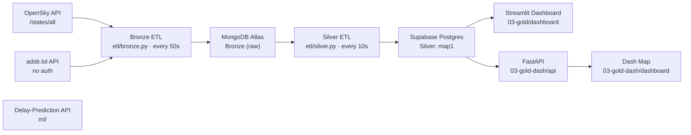

# System Design — Airline Data Engineering Platform

A plain-English summary of how the whole platform fits together, what went wrong along the way and
how it was fixed, and how the work is evaluated. For the detailed *why* behind each choice, see the
[ADRs](https://github.com/pavelborovskikh/airline-cloud-data-platform/blob/main/docs/adr/README.md); for the current-state diagrams, see [architecture/](https://github.com/pavelborovskikh/airline-cloud-data-platform/blob/main/docs/architecture/README.md).

---

## 1. The system at a glance

Live flight positions are pulled from two public APIs, stored raw, cleaned into one table, and
shown on two live-map dashboards. A separate, self-contained ML service predicts flight delays from
a Kaggle dataset.

The design follows the **medallion** pattern: **Bronze** = raw data exactly as received,
**Silver** = cleaned and flattened, **Gold** = what end users consume.

---

## 2. Elements of the system

### Data sources

| Element | What it is, in plain English |
|---|---|
| **OpenSky `/states/all`** | Free API that returns every aircraft currently in the air inside a bounding box (here: latitude 47–52°, longitude 5–15°, roughly southern/central Germany around Frankfurt; started as a ~150×150 km Frankfurt box). Needs a login token. Preferred source because it is the richer of the two. |
| **adsb.lol** | Free community API with the same kind of live positions, no login. Used as a backup when OpenSky can't be reached. It takes a circle (centre + radius) instead of a box. |
| **Kaggle "Airlines Delay" dataset** | A static CSV of 539,382 historical flights, used only by the ML service. |

### Bronze — raw landing zone

| Element | What it is |
|---|---|
| **Bronze ETL (`etl/bronze.py`, `run_bronze.sh`)** | A small Python script in a Docker container that runs in a loop every 50 seconds. Each run fetches a snapshot from both APIs and saves it untouched. 50s was picked so the OpenSky daily credit budget is never exhausted. |
| **MongoDB Atlas** | A managed (cloud-hosted) document database. Holds the raw snapshots in two collections: `states_all` (OpenSky) and `adsb_raw` (adsb.lol). Storing raw JSON means the data can be re-processed later if the transformation changes ("ingestion ≠ modelling"). Old documents expire automatically after 24 h (TTL index) so the free 512 MB tier never fills up. |

### Silver — cleaned layer

| Element | What it is |
|---|---|
| **Silver ETL (`etl/silver.py`, `run_silver.sh`)** | Runs in its own container every 10 seconds. Reads the newest snapshot from MongoDB — whichever source is **freshest wins** — flattens it into rows and replaces the contents of `map1`. No manual failover: if OpenSky goes stale, adsb.lol takes over automatically, and vice versa. Uses raw SQL via `psycopg2` (no ORM) so every query is visible. |
| **Supabase Postgres — `map1` table** | A managed Postgres database. `map1` is one flat table: one row per aircraft with its ID (`icao24`), callsign, position, heading, vertical speed, on-ground flag and `updated_at` (when the data was captured). Its DDL is versioned in `etl/sql/map1.sql`. |

### Gold — consumption

| Element | What it is |
|---|---|
| **Streamlit Dashboard (`03-gold/dashboard`)** | A live map and table of aircraft. Reads `map1` directly with `psycopg2`. |
| **FastAPI service (`03-gold-dash/api`)** | A read-only REST API (`/health`, `/aircraft/current`) on top of `map1`, using async `asyncpg` through Supabase's IPv4-friendly session pooler. |
| **Dash Map (`03-gold-dash/dashboard`)** | A second, independent map frontend that calls the FastAPI service every 45 seconds instead of touching the database. Shows the "API in front of the database" pattern. |
| **Landing page (`deployment/landing-page`)** | A static HTML page linking to all the services. |

### ML service

| Element | What it is |
|---|---|
| **Training pipeline (`ml/src/airline_delay`)** | Loads the Kaggle CSV, engineers features, trains three candidate models, picks the best, tunes it and evaluates it once on held-out data. Output: `models/model.joblib` + `metadata.json`. |
| **Prediction API (`ml/api`)** | FastAPI with `/health`, `/model/info`, `/predict`, `/predict/batch`, protected by an API key. Ships with the trained model, so it needs no database and no data download. |

### Deployment and infrastructure

| Element | What it is |
|---|---|
| **Production VM** | One small AWS Lightsail virtual machine that runs every application container. The databases are *not* on it — they are managed cloud services. |
| **Docker + Docker Compose** | Every service is a container. One Compose file per independently deployable service in `deployment/*.yml`. |
| **Portainer GitOps** | Portainer watches the `main` branch and redeploys a stack automatically when its Compose file changes. Nobody runs `docker compose up` by hand on the server. |
| **GitHub Actions (`build-push.yml`)** | Builds every image once and pushes it to GitHub Container Registry (GHCR). The VM only *pulls* images, never builds. Each image gets an immutable `sha-…` tag plus `latest` (on `main`) or `pr-<N>` (on pull requests). |
| **Q (stage) environment** | A second, smaller VM created with **Terraform** (`infra/q-vm/`). On every pull request, CI points the Q stacks at the PR's images so the whole pipeline can be tried before merging. Q writes to its own `q_map1` table so it can never overwrite production data. `q-reset.yml` puts Q back to `latest` after the merge build finishes. |
| **Cloudflare Tunnel (`cloudflared`)** | The only way in from the internet. A small connector on each VM dials *out* to Cloudflare, which then routes each public subdomain to a local port. The VMs have no open web ports at all and need no TLS certificates. |
| **Mono-repo** | Code, deployment files, Terraform and docs all live in this one repository, so one PR can change a service and how it is deployed together. |
| **GitHub Flow** | Feature branch → pull request → review by a teammate → squash-merge into `main`. No direct pushes to `main`. |

---

## 3. What went wrong and how it was fixed

| # | Problem (plain English) | Fix |
|---|---|---|
| 1 | **Lufthansa API never arrived.** The original assignment assumed a Lufthansa API key that was never provided. | Switched to free sources (OpenSky + adsb.lol) and made MongoDB a multi-source landing zone (ADR 004). |
| 2 | **Wrong OpenSky endpoint.** The team first used OpenSky's `/flights/*` endpoints, which turned out to be *historical* (24–30 h delay), not live. | Switched to the truly live `/states/all` endpoint and dropped the flights model (ADR 009). |
| 3 | **Shared training VM was unreliable.** The course VM changed IP on every reboot, had no backups, and blocked OpenSky. | Moved MongoDB to Atlas (ADR 006), moved compute to a dedicated VM and Postgres to a managed service (ADR 007). |
| 4 | **OpenSky blocks AWS.** OpenSky refuses all traffic from AWS IP ranges, so on the production VM the OpenSky feed went stale forever and the map would have frozen. | adsb.lol was promoted from "backup storage only" to an automatic Silver fallback: the freshest snapshot always wins (ADR 014). |
| 5 | **Pipeline could hang.** The OpenSky login request had no timeout, so a blocked network froze the whole ETL instead of failing over. | Added a timeout. |
| 6 | **Silent 3-day outage.** One temporary database error ended the ETL script (`set -e`), and the container had no restart policy, so it sat stopped for 3 days while the map showed stale data. | Container now restarts automatically; one failed cycle no longer kills the loop. |
| 7 | **Table locks.** `TRUNCATE map1` locked the whole table, blocking the dashboards' reads and hitting the database timeout — the actual trigger for #6. | Replaced with `DELETE`, which does not block readers. |
| 8 | **Wrong database login format.** The ETL used the connection-pooler username style against the direct database port, so every write failed. | Corrected the username format. |
| 9 | **IPv6-only database vs. IPv4-only Docker.** Supabase's direct endpoint is IPv6-only; Docker's default network has no IPv6, giving "Network is unreachable". Also an older port (6543) was retired by Supabase. | Dashboard and Silver ETL use `network_mode: host`; the FastAPI uses the IPv4-compatible session pooler on port 5432. |
| 10 | **A hotfix merged too quickly.** A small, correct-looking fix (PR #24) was merged on sight, but it belonged inside a larger change and had to be reverted (PR #25). | Folded into the larger PR #26; rule added: always ask before merging, even small fixes. |
| 11 | **5-second scheduling proposal.** A proposed systemd timer every 5 s would have used ~8.6× the OpenSky daily credit budget and lost Portainer visibility. | Kept the Docker loop; split into Bronze every 50 s (72 % of credit budget) and Silver every 10 s (ADR 015). |
| 12 | **Database filling up.** `adsb_raw` grew ~717 MB/day into a 512 MB free cluster and blocked writes. Two causes: the adsb.lol circle was much bigger than needed, and the 24 h auto-delete never ran because timestamps were stored as text instead of real dates. | Shrank the radius 245 → 150 NM (~307 MB/day), stored real dates so the TTL index works, and made Silver accept both formats during the migration. |
| 13 | **"Last updated: n/a".** The Silver insert never filled `updated_at`, so the dashboard couldn't show freshness. | `updated_at` is now set to the snapshot's capture time (issue #39). |
| 14 | **Logs filling the disk / lost logs.** Docker's default log driver never rotates, and log files written inside containers vanished on redeploy. | Switched to the rotating `local` log driver and log to stdout only. |
| 15 | **Q environment hiccups.** The VM boot script used bash syntax but Lightsail runs it with `sh`; the Portainer redeploy call used POST instead of PUT; a hand-typed fix crash-looped the Q API; resetting Q on PR close raced the build and could make an old image write to production's table. | POSIX-only boot script; PUT; one shared deploy script used by both CI and humans; reset only after the `main` build finishes. |
| 16 | **Secrets leaked into docs.** Real VM IPs and a database project reference appeared in ADRs and a public issue. | Redacted; private pointers now live only in the git-ignored `CLAUDE.local.md`, and every publish is checked first. |
| 17 | **Hand-made table not versioned.** `map1` had been created by clicking in Supabase, so it could not be rebuilt. | DDL recovered and committed as `etl/sql/map1.sql`. |

---

## 4. Evaluation elements and metrics

### How the project is graded

Built as the capstone of the DataScientest Data Engineer bootcamp. The mentor stated that the main
evaluation criterion is **Data Engineering mastery**, not ML performance. Graded deliverables by
step:

| Step | Evaluated element | Where it is in this repo |
|---|---|---|
| 1 — Data discovery & organisation | Collecting live data, NoSQL landing zone, relational schema, ER/UML docs | `etl/bronze.py`, MongoDB Atlas, `docs/architecture/silver-layer-er.md` |
| 2 — Data consumption & API | ETL raw → curated, REST API | `etl/silver.py`, `03-gold-dash/api` |
| 3 — Automation & pipelines | Scheduled collection and ETL | `run_bronze.sh` / `run_silver.sh` loops (ADR 015) |
| 4 — Deployment & frontend | Docker, CI/CD, dashboard | `deployment/`, `.github/workflows/`, both dashboards, Q environment |
| Final defence | Architecture presentation, live demo, defence of design decisions | `docs/adr/`, `docs/report/` |

### Operational metrics used in design decisions

| Metric | Value | Why it matters |
|---|---|---|
| OpenSky credit use | 2 credits/call × 1,440 calls/day = 2,880 of 4,000 (72 %) | Chosen Bronze cadence of 50 s stays under the daily limit. |
| Bronze / Silver cadence | 50 s / 10 s | Bronze is rate-limited by APIs; Silver is local and can refresh faster. |
| adsb.lol storage | ~717 MB/day → ~307 MB/day (642 → 282 aircraft per snapshot) | Must fit a 512 MB free cluster with a 24 h TTL. |
| OpenSky query area | 47–52° N, 5–15° E (~50 square degrees) | A box this size costs 2 credits per call instead of 4 for the whole globe. |
| Dash polling interval | 45 s | Frontend refresh rate of the API-backed map. |

### ML model evaluation (delay prediction)

Data split 70 / 15 / 15 (train / validation / test), stratified. Models compared on validation
**ROC-AUC** (how well the model ranks delayed above on-time flights; 0.5 = random, 1.0 = perfect):

| Model | Validation ROC-AUC | Validation F1 |
|---|---|---|
| **HistGradientBoosting (selected)** | **0.708** | 0.553 |
| Logistic Regression (baseline) | 0.682 | 0.536 |
| Random Forest | 0.654 | 0.561 |

Final, one-time test-set result (80,908 unseen flights):

| Metric | Value | Meaning |
|---|---|---|
| Accuracy | 0.667 | Share of all predictions that were right |
| Precision | 0.667 | Of flights predicted "delayed", how many really were |
| Recall | 0.506 | Of truly delayed flights, how many were caught |
| F1 | 0.576 | Balance of precision and recall |
| ROC-AUC | 0.721 | Ranking quality, in line with published results for this dataset |
| PR-AUC | 0.681 | Precision/recall trade-off across thresholds |

Permutation feature importance: `Airline` (0.143) and `Time` (0.068) matter most; `Flight` number
scored exactly 0.0 and was removed from the model. The score ceiling is explained by missing drivers
(weather, air traffic control, knock-on delays) that the dataset doesn't contain.

### Quality checks

- **pytest suite** for the ML service (`ml/tests/`: data loading, features, API).
- **CI build validation**: every pull request builds all images, so a broken Dockerfile is caught
  before merge.
- **Q environment**: each PR runs the full pipeline on a stage VM before merging.
- **Health checks** on the containers (`/health` endpoints, Docker `HEALTHCHECK`).
- **Peer review** of every PR (GitHub Flow, ADR 012).
