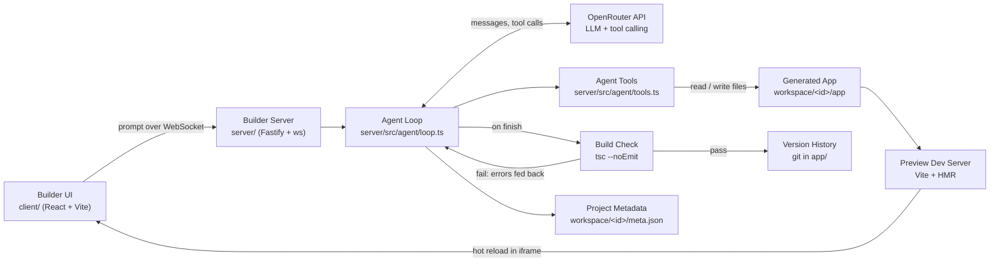

# System Design — Personal App Builder at Home

A plain-English summary of how the builder works, what went wrong during the build and how it was
corrected, and how the system is evaluated. The full build spec is [`PLAN.md`](https://github.com/pavelborovskikh/personal-app-builder-at-home/blob/main/PLAN.md); the
phase-by-phase build prompts are in [`phases/`](https://github.com/pavelborovskikh/personal-app-builder-at-home/tree/main/phases).

---

## 1. The system at a glance

You type a prompt ("make a pomodoro timer"), an AI agent writes a React app on your machine, and a
live preview next to the chat updates itself as the files change.

Two things run side by side: **the builder** (our tool) and **the generated app** (a real Vite dev
server running as a child process, shown inside an iframe).

---

## 2. Elements of the system

### Builder

| Element | What it is, in plain English |
|---|---|
| **Builder UI (`client/`)** | A two-pane web page: chat on one side, live preview iframe on the other. Shows the agent's progress live (text, tool calls, "checking build…", "fixed after N tries", "couldn't fix, here's the error"), running cost, and a "restore this version" button per turn. Built with the same React + Vite + Tailwind stack it generates. |
| **Builder Server (`server/src/index.ts`, `routes/`)** | A Fastify web server on port 4000. REST endpoints to create/list/get projects, restore a version and restart a crashed preview; a WebSocket per project that streams agent events to the UI. |
| **Project manager (`workspace/projectManager.ts`)** | Creating a project copies the template, runs `npm install`, makes a first git commit, assigns a free port (from 5175 up), starts the dev server, and writes `meta.json`. |
| **Template (`templates/base-react-app`)** | The starting app: Vite + React + TypeScript + Tailwind. Deliberately one narrow, well-known stack so the model makes fewer mistakes. |

### The AI agent

| Element | What it is |
|---|---|
| **OpenRouter client (`agent/openrouter.ts`)** | Calls OpenRouter's OpenAI-compatible chat API with tool calling. The model is chosen by the `OPENROUTER_MODEL` setting, never hard-coded. The API key stays on the server only. |
| **Agent loop (`agent/loop.ts`)** | The heart of the system. Repeatedly: send the conversation to the LLM → if it asks to use a tool, run the tool and send back the result → continue until the model calls `finish`. Capped at 25 steps per turn. |
| **Tools (`agent/tools.ts`)** | The *only* actions the AI can take: `list_files`, `read_file`, `write_file`, `delete_file`, `install_package`, `finish`. There is deliberately **no "run any shell command" tool**, which limits the damage a bad or manipulated model response can do. |
| **Path containment (`workspace/fsTools.ts`, `paths.ts`)** | Every file path is resolved and checked to be inside the project's `app/` folder; anything outside is refused with an error message instead of a crash. |
| **Package installer** | `install_package` checks the package name against an npm-name pattern and runs `npm install` with a fixed argument list (no shell string), so a malicious name can't inject commands. |
| **Context builder (`agent/context.ts`, `prompts.ts`)** | Builds what the LLM sees each step: the system prompt, a file tree (names and sizes only, not contents), and the most recent ~20 messages, cut at turn boundaries. The model must `read_file` to see contents. This keeps token cost from growing with project size. |
| **Cost tracker (`agent/pricing.ts`)** | Reads the model's per-token price from OpenRouter's model list, multiplies by the tokens reported in every response, and keeps a running total per project. Stops calling the LLM once `MAX_SPEND_USD` (default $90) is reached. |

### Validation, versioning and preview

| Element | What it is |
|---|---|
| **Build check (`workspace/validate.ts`)** | After the agent says "finish", the server runs the TypeScript compiler (`tsc --noEmit`) to make sure the app actually compiles before believing it's done. |
| **Self-healing retries** | If the build check fails, the real compiler errors are sent back to the agent as "Build check failed … please fix", up to `MAX_VALIDATION_RETRIES` (default 3). If it still fails, the raw errors are shown to the user instead of a fake "done". |
| **Version history (`workspace/git.ts`)** | Each project's `app/` folder is its own git repository. Every turn that passes the build check becomes a commit with the agent's summary as the message. "Restore this version" is a `git checkout` of that commit. |
| **Project metadata (`db/meta.ts`)** | A `meta.json` file per project with chat history, port, model, token usage, cost, spend-limit flag and preview status. It sits *next to* `app/`, not inside it, so an agent mistake can break generated files but never the bookkeeping. A database was judged overkill for a single-user tool. |
| **Dev server manager (`workspace/devServerManager.ts`)** | Starts, stops and restarts each project's Vite dev server. Ordinary file edits reach the preview through Vite's own hot reload — no custom refresh logic. Only a change to `package.json` or build config triggers a dev-server restart and a hard iframe reload. A crashed dev server is marked "crashed" with a restart button. |
| **Cross-platform process helpers (`workspace/npmExec.ts`)** | Run npm and `tsc` as `node <script.js>` instead of through shell shims, so the same code works on Windows, macOS and Linux without `shell: true`. |

### Configuration (`server/.env`)

`OPENROUTER_API_KEY`, `OPENROUTER_MODEL`, `PORT`, `WORKSPACE_DIR`, `PREVIEW_PORT_START`,
`MAX_SPEND_USD`, `MAX_STEPS_PER_TURN`, `MAX_VALIDATION_RETRIES`. The three `MAX_*` limits are a
**safety** mechanism as much as a budget one: they stop a confused retry loop from running (and
spending) forever.

---

## 3. What went wrong and how it was fixed

| # | Problem (plain English) | Fix |
|---|---|---|
| 1 | **Broken setup on macOS/Linux.** The code assumed npm always sits next to the `node` program (true for the Windows installer). With nvm, Homebrew or the Unix tarball, npm lives elsewhere, so creating projects, installing packages and starting the preview all failed silently. | `npmExec.ts` now checks both layouts; verified against a real nvm install. |
| 2 | **Orphaned preview servers.** Stopping a preview only stopped the outer `npm` process, not the actual `vite` process underneath. The old server kept running and kept the port, so a restarted preview couldn't start. | Kill the whole process tree: process groups on macOS/Linux, `taskkill /T` on Windows. |
| 3 | **"0" treated as "not set".** Reading `MAX_VALIDATION_RETRIES=0` with the usual `Number(x) \|\| default` turned 0 into the default (3), which broke the test that forces the "can't auto-fix" path. | A small env parser that keeps an explicit 0. |
| 4 | **Retries eating the step budget.** Each build-check retry counted as a step, so a retry could leave the agent too few steps to actually make the fix. | Retry round trips no longer count against the 25-step limit. |
| 5 | **Extra field sent to the API.** Stored chat messages carry a `commitHash` (for "restore this version") that OpenRouter's API doesn't expect. | Messages are stripped back to the API's shape before sending. |
| 6 | **Leftover old project name.** After renaming the project, some runtime strings (git commit author, agent system prompt) still used the old name. | Cleaned up in the same fix as #1. |
| 7 | **"Done" that wasn't done.** Early on (by design of phase 2/3) the agent could declare success on code that didn't compile. | Phase 4 added the `tsc` build check and self-healing loop, with a visible error when it can't recover. |

---

## 4. Evaluation elements and metrics

This is a personal proof-of-concept, so it is evaluated by **acceptance checks**, not a benchmark.
The project was built in phases; each phase had a hands-on check that had to pass before the next
phase started ("don't build on a broken phase").

### Acceptance checks per phase

| Phase | Goal | Check that had to pass |
|---|---|---|
| 0 | Skeleton | Server and client install and start cleanly; `/health` returns `{status: "ok"}`; two-pane layout visible. |
| 1 | Scaffold + live preview | "New project" creates `workspace/<id>/app` with its own git repo; editing `App.tsx` by hand updates the iframe without a reload. |
| 2 | Single-shot LLM | "Make a pomodoro timer" rewrites `App.tsx` and the preview shows a timer. |
| 3 | Agent loop | "Add a dark mode toggle" — the agent reads existing files before editing, changes several files, and the preview updates. |
| 4 | Validation + self-healing | A prompt designed to trip the model up is fixed automatically; with `MAX_VALIDATION_RETRIES=0` the real error is shown instead of a false "done". |
| 5 | History, versioning, cost | Browser refresh restores chat and preview; a deliberately broken app can be restored to a good version; the running cost is visible. |
| 6 | Stretch goals | Not started. |

Status: phases 0–5 complete.

### Runtime metrics tracked by the system

| Metric | Where | Purpose |
|---|---|---|
| Prompt and completion tokens per call | `meta.json` → `usage` | Cost visibility; context-size control. |
| Cost in USD per project | `meta.json` → `costUsd`, shown in UI | Hard stop at `MAX_SPEND_USD` (default $90). |
| Steps per turn | agent loop | Hard stop at `MAX_STEPS_PER_TURN` (default 25). |
| Build-check attempts | agent loop, shown in UI | Up to `MAX_VALIDATION_RETRIES` (default 3); "fixed after N tries" or unresolved errors. |
| Build result (`tsc` pass/fail) | validation | Only passing turns become git commits. |
| Preview status (running/crashed) | `meta.json` → `devServer` | Shows a restart button instead of a dead iframe. |

### Not yet covered

- Runtime errors in the browser (app compiles but crashes when used) are not fed back to the agent —
  only compile errors are. Listed as a possible phase 6 improvement.
- No automated test suite; verification is the manual acceptance checks above.
