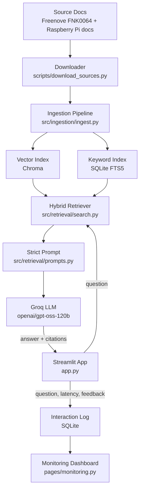

# System Design — PicoKit Copilot

A plain-English summary of how PicoKit Copilot works, what went wrong during the build and how it
was corrected, and how the system is evaluated. Detailed reasoning for each choice lives in the
[ADRs](https://github.com/pavelborovskikh/picokit-copilot/tree/main/docs/adr); full evaluation outputs live in [`reports/`](https://github.com/pavelborovskikh/picokit-copilot/tree/main/reports).

---

## 1. The system at a glance

PicoKit Copilot is a **RAG** (retrieval-augmented generation) assistant: before the LLM answers, the
app looks up the most relevant passages from a small, curated documentation set and tells the LLM to
answer **only** from those passages, with numbered citations.

Two halves:
- **Offline (build time):** download → clean → chunk → embed → index. The finished index is
  committed to git, so users never need to run this.
- **Online (run time):** question → retrieve → prompt → LLM → answer with sources → log.

---

## 2. Elements of the system

### Knowledge base (offline)

| Element | What it is, in plain English |
|---|---|
| **Source manifest (`data/manifests/sources.yaml`)** | The list of 5 public pages from 3 sources (Freenove kit docs, Raspberry Pi Pico-series docs, Raspberry Pi MicroPython docs), with URLs and licences. Keeps the corpus explicit and reproducible. |
| **Downloader (`scripts/download_sources.py`)** | Fetches each page, saves it with a fixed file name and records a SHA-256 hash, status and timestamp. Waits 8 s between requests to raspberrypi.com (which blocks bots) and retries on 403/429/5xx. |
| **Ingestion pipeline (`src/ingestion/ingest.py`)** | Strips each page down to its main content, splits it by section into chunks (max 1,200 characters, 150 overlap), keeps code blocks separate from prose, and attaches metadata (source, URL, section, content type). Result: **97 chunks** (88 prose, 9 code). Re-running gives the same result (deterministic chunk IDs). |
| **Embedding model (`BAAI/bge-small-en-v1.5`)** | A small local model that turns text into 384-number vectors so that similar meanings end up close together. Runs on CPU, free, no API key. Questions get a special prefix; passages don't (the model is trained that way). |
| **Vector index (Chroma)** | A file-based vector database that finds chunks with *similar meaning* to the question. No separate server needed. |
| **Keyword index (SQLite FTS5)** | A full-text search index using BM25 ranking that finds chunks with the *same words* as the question — good for exact terms like pin numbers or file names. |
| **Committed index (`data/vector_store/`, ~1.7 MB)** | Both indexes are checked into git and copied into the Docker image, so the app runs from a fresh clone without re-ingesting or re-downloading anything. |

### Answering a question (online)

| Element | What it is |
|---|---|
| **Retriever (`src/retrieval/search.py`)** | Supports three modes, switchable by one setting: `vector`, `keyword`, or **`hybrid`** (default). Hybrid takes the top 20 candidates from each index and merges the two ranked lists with **reciprocal rank fusion** (RRF, k=60): a chunk ranked high in either list ends up high overall. Returns the top 5. |
| **Prompt configs (`src/retrieval/prompts.py`)** | Two prompt styles. **`strict`** (default): answer only from the passages, say what's missing, cite with `[n]`, never invent specifics, give board-specific steps. `basic`: a looser version kept for comparison. |
| **Answer generator (`src/retrieval/baseline.py`)** | Builds the prompt, calls the LLM, normalises odd citation symbols to plain `[n]`, and returns the answer with its sources. Shared by the CLI and the web app so both behave the same. |
| **LLM (Groq, `openai/gpt-oss-120b`)** | The language model that writes the answer, called via Groq's fast, free-tier API. Temperature 0.1 (low creativity). `gpt-oss-20b` is the fallback when rate-limited. |
| **Streamlit app (`app.py`)** | The web page: question box, answer, clickable source links, a "retrieved context" panel, latency info, and 👍/👎 feedback with an optional note. The sidebar lets the user change retrieval mode, prompt style and number of passages. |

### Monitoring

| Element | What it is |
|---|---|
| **Interaction log (`src/monitoring/interaction_log.py`)** | A SQLite table with one row per answered question: anonymous session ID, question, settings, retrieved chunk IDs, retrieval and generation time, tokens, answer length, and feedback. A 👍/👎 updates the same row. |
| **Monitoring dashboard (`pages/monitoring.py`)** | A second Streamlit page with KPI tiles and six charts (see section 4). The data-shaping code is kept separate from the UI so it can be unit-tested. |

### Packaging

| Element | What it is |
|---|---|
| **Docker image (`Dockerfile`)** | Python 3.12 slim, CPU-only PyTorch, the embedding model and the committed index baked in, runs as a non-root user, works offline except for the Groq call. ~3.1 GB on disk / ~700 MB compressed. |
| **Docker Compose (`docker-compose.yml`)** | Starts the app on port 8501 with a health check. The interaction log lives in a named Docker volume (`picokit-runtime`) so feedback survives restarts. |
| **Config (`src/config.py`, `.env`)** | All knobs (model, retrieval mode, prompt, top-k, paths, chunk sizes) are environment variables with sensible defaults. Only `GROQ_API_KEY` is required. |

---

## 3. What went wrong and how it was fixed

| # | Problem (plain English) | Fix |
|---|---|---|
| 1 | **LLM model disappeared.** The first chosen model, Groq's `llama-3.3-70b-versatile`, was removed from Groq's catalogue and started returning "404 not found". | Switched to `openai/gpt-oss-120b`, with `gpt-oss-20b` as fallback (ADR 0003 → superseded by ADR 0004). |
| 2 | **Wrong retrieval default chosen first.** The retrieval test favoured `keyword` mode, so it became the default. But that test only checked whether the right *page* was found, not the right *chunk*. The answer test then showed keyword often found the right page but missed the exact passage with the answer, so the LLM had to say "not covered" on detail questions. | Default changed to `hybrid` (ADR 0005 → superseded by ADR 0007). Strict-prompt score rose from 7.38 to 7.69 / 8, all from better completeness. |
| 3 | **LLM judge rewarded guessing.** The automated judge gave the `basic` prompt a slightly higher completeness score — because it filled gaps with invented details (for example made-up firmware file names). The judge was also inconsistent: the same answer scored 2 in one run and 0 in another. | Every LLM-judge run is now human spot-checked (mandatory). `strict` was chosen because it never invents details (ADR 0006). |
| 4 | **Huge install size.** Default PyTorch pulled ~15 NVIDIA GPU packages that a CPU-only app never uses; the virtual environment was 6.1 GB. | Pinned the CPU build of PyTorch: 6.1 GB → 1.7 GB. No GPU packages in the Docker image either. |
| 5 | **Licensing problem with raw docs.** To make Docker builds work offline, the downloaded source HTML was committed. But the repo is public and the Freenove docs are licensed non-commercial / "verify before redistribution". | Reverted. The *built index* (cleaned, chunked text + embeddings) is committed instead, and raw HTML stays out of git (ADR 0008). |
| 6 | **Flaky builds.** Building the index inside Docker would need to download from raspberrypi.com, which randomly blocks automated requests. | Same fix as #5 — the image copies the pre-built index; no network needed at build time. |
| 7 | **Feedback database failed on Windows/WSL.** The interaction log was stored in a folder bind-mounted from the host; on WSL the file ownership didn't match the container user, so SQLite couldn't open it. | Switched to a Docker named volume, which has the right ownership automatically. |
| 8 | **Inaccurate latency numbers.** The very first question of each session includes loading the model and index, which inflates retrieval time. | The monitoring page excludes each session's first query from retrieval latency. |
| 9 | **Fancy citation brackets.** The model sometimes wrote full-width `【1】` citations instead of `[1]`. | Citations are normalised to plain ASCII `[n]`. |
| 10 | **Risk of committing secrets.** | `.env` is git-ignored; only the placeholder `.env.example` is tracked (verified no `.env` was ever committed). |

---

## 4. Evaluation elements and metrics

Built as a **DataTalksClub LLM Zoomcamp** capstone. The project covers the evaluated building blocks
of a RAG application: problem description, ingestion pipeline, retrieval evaluation, LLM/answer
evaluation, user interface, monitoring with user feedback, containerisation and reproducibility.
All evaluation code is offline and separate from the app (`src/eval/`); inputs are in `data/eval/`,
results in `reports/`.

### Retrieval evaluation

- **Test set:** 29 hand-written questions, each labelled with the source(s) that should be found.
  Categories: setup, pin wiring, library installation, error diagnosis, code explanation, hardware
  spec.
- **Metrics** (at k = 5):
  - **hit@5** — was at least one correct source in the top 5?
  - **recall@k** — what share of the correct sources appear in the top k?
  - **MRR** (mean reciprocal rank) — how high the first correct result is ranked (1.0 = always
    first, 0.5 = usually second).

| Mode | hit@5 | recall@1 | recall@3 | recall@5 | MRR |
|---|---|---|---|---|---|
| vector | 1.000 | 0.810 | 0.914 | 0.983 | 0.911 |
| keyword | 1.000 | 0.845 | 0.966 | 1.000 | 0.938 |
| **hybrid (chosen)** | 0.966 | **0.879** | 0.966 | 0.966 | **0.948** |

### Answer (LLM) evaluation

- **Test set:** 16 of the questions, each with an evidence checklist.
- **Method:** answers generated by `gpt-oss-120b`, scored by an LLM judge from a *different model
  family* (`qwen/qwen3.8-27b`, to avoid a model grading itself), then human spot-checked.
- **Rubric:** four dimensions, 0–2 points each, total out of 8:
  - **Groundedness** — is every claim supported by the retrieved passages?
  - **Completeness** — does it cover what the question needs?
  - **Safety** — no risky or invented hardware advice?
  - **Citation quality** — are the `[n]` references correct and useful?

| Prompt | Groundedness | Completeness | Safety | Citation | Total |
|---|---|---|---|---|---|
| basic | 1.81 | 1.75 | 1.94 | 1.94 | 7.44 / 8 |
| **strict (chosen)** | **2.00** | 1.69 | **2.00** | **2.00** | **7.69 / 8** |

### Live monitoring metrics (dashboard)

- **KPI row:** total interactions, sessions, feedback rate, % helpful.
- **Charts:** queries over time · feedback distribution (👍 / 👎 / none) · latency p50 and p95 for
  retrieval and generation · retrieval-mode usage · top query terms · which sources were retrieved.

### Software quality

- **61 automated tests** (`pytest`, all offline): ingestion, lexical search, RRF maths, metric
  calculations, judge-output parsing, interaction log, dashboard data shaping, and Streamlit page
  smoke tests.
- **Docker clean-room check:** a fresh `git clone` + `docker compose up --build` must come up healthy
  and give a cited answer.

### Known limits of the evaluation

- Retrieval is scored per *source*, not per *chunk*, so it can miss "right page, wrong passage"
  errors (exactly what caused problem #2).
- The LLM judge is non-deterministic and under-penalises invention, so the human check stays
  mandatory.
- Two known retrieval gaps remain: a millisecond-delay question (correct page lands at rank 6) and
  the debounce question (the 20 ms `sleep_ms` chunk is never retrieved).
